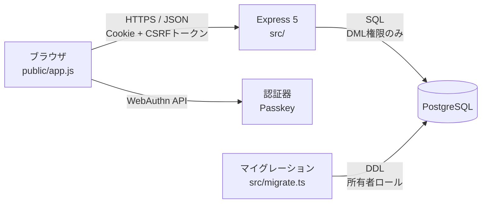
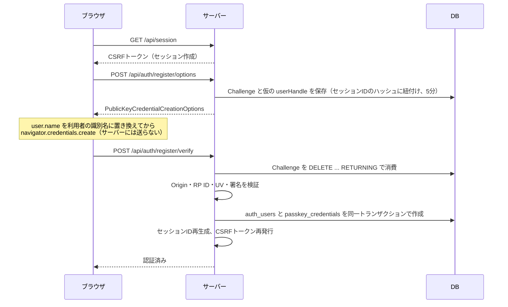
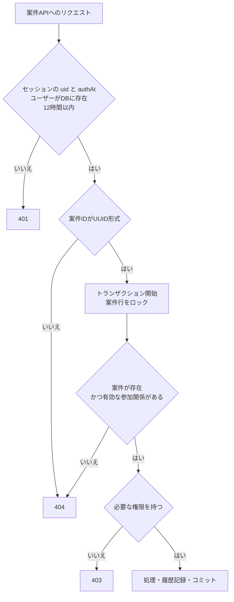

# ARCHITECTURE

## システム構成

- 単一のNode.jsプロセスとPostgreSQLの構成
- TypeScriptはNodeの型除去で直接実行し、ビルド成果物を持たない
- フロントエンドはビルドなしのES Module
  - `@simplewebauthn/browser` を `/vendor/simplewebauthn/` として配信する
- 状態はすべてPostgreSQLに置く（セッション・Challengeを含む）

## コンポーネントの責務

| ファイル | 責務 |
| --- | --- |
| `src/app.ts` | ミドルウェアの順序（セキュリティヘッダー → 静的配信 → JSON → セッション → CSRF → ルート） |
| `src/config.ts` | 環境変数の検証。本番でのhttp・非Secure Cookieを拒否 |
| `src/security.ts` | セキュリティヘッダー、CSRF検査（Origin一致・JSON・トークン） |
| `src/session.ts` | サーバー側セッション、認証必須・再認証必須のミドルウェア |
| `src/webauthn.ts` | 登録・ログイン・再認証・Passkey追加のCeremony。Challengeの発行と一回限りの消費 |
| `src/projects.ts` | 案件アクセスの共通入口 `withProject`（ロック・参加判定・権限判定） |
| `src/routes/auth.ts` | 認証・Passkey管理・アカウント削除のAPI |
| `src/routes/projects.ts` | 案件・案件情報・参加者・招待のAPI |
| `src/account.ts` | アカウント削除時の案件の扱い（削除・退出・拒否）の判定と実行 |
| `src/migrate.ts` | 番号順のSQLマイグレーション。適用済みファイルの改変を検出 |
| `migrations/` | スキーマ、DB制約、整合性トリガー |

## ER図

```mermaid
erDiagram
  auth_users ||--|{ passkey_credentials : "1件以上"
  auth_users ||--o{ sessions : ""
  auth_users ||--o{ webauthn_challenges : "再認証・追加時"
  auth_users ||--o{ project_memberships : ""
  projects ||--|{ project_memberships : "管理者1人以上"
  project_memberships ||--o{ project_permissions : ""
  projects ||--o{ project_invitations : ""
  project_invitations ||--o{ project_invitation_permissions : ""
  projects ||--o{ project_products : ""
  projects ||--o{ project_work_schedules : ""
  projects ||--o| project_contracts : ""
  projects ||--o{ project_events : ""
  projects ||--o{ project_audit_log : ""

  auth_users {
    uuid id PK
    bytea webauthn_user_handle UK "32byte乱数"
    timestamptz created_at
  }
  passkey_credentials {
    uuid id PK
    uuid user_id FK
    text credential_id UK
    bytea public_key
    bigint sign_count
    text_array transports
    enum device_type
    bool backed_up
  }
  sessions {
    varchar sid PK
    jsonb sess
    timestamptz expire
    uuid user_id FK "sessから生成"
  }
  webauthn_challenges {
    uuid id PK
    bytea session_hash "SHA-256"
    enum ceremony
    text challenge UK
    uuid user_id FK
    bytea pending_user_handle
    timestamptz expires_at
  }
  projects {
    uuid id PK
    text name
    enum status
  }
  project_memberships {
    uuid id PK
    uuid project_id FK
    uuid user_id FK
    enum role "表示用。認可に使わない"
    enum status "pending_approval / active"
    timestamptz valid_until
  }
  project_permissions {
    uuid membership_id PK
    enum permission PK
  }
  project_invitations {
    uuid id PK
    uuid project_id FK
    bytea token_hash UK "SHA-256"
    enum role
    bool requires_approval
    enum status "pending / accepted / revoked"
    timestamptz expires_at
  }
  project_contracts {
    uuid project_id PK
    text contract_reference
    bigint amount_jpy
    enum billing_status
  }
  project_events {
    uuid id PK
    bigint seq UK
    enum event_type
    uuid actor_membership_id "FKなし"
  }
  project_audit_log {
    uuid id PK
    bigint seq UK
    enum action
    uuid actor_membership_id "FKなし"
    uuid target_membership_id "FKなし"
    enum_array permissions
  }
```

### データモデルの要点

- 主キーはすべて `gen_random_uuid()`（122bitの乱数）
- 状態・役割・権限・イベント種別はPostgreSQLのENUM
- 現在状態と履歴を分ける
  - 現在の参加者と権限は `project_memberships` / `project_permissions`
  - 失効した参加関係は行を削除し、履歴は `project_audit_log` に残す
  - 案件の業務イベントは `project_events`
- 履歴の実行者・対象は参加関係IDで記録し、ユーザーIDを持たない
  - 参加関係IDは案件ごとに異なるため、履歴から案件をまたいで同一人物を結合できない
  - 参加関係の削除後は、履歴から個人へたどれない
- 案件情報は閲覧範囲ごとにテーブルを分ける
  - `project_products` / `project_work_schedules`: `details.*`
  - `project_contracts`: `contract.*`
- JSONは `sessions.sess`（express-sessionの形式）だけで使う
  - 中身は `csrf`、`uid`、`authAt`、`reauthAt` の4項目
  - `user_id` を生成列として取り出し、外部キーにしている

### DBが保証する整合性

アプリのバグや直接のSQL操作でも崩れないよう、次の規則はDBで強制する

| 規則 | 実装 |
| --- | --- |
| 案件には有効期限のない有効な管理者が1人以上いる | 遅延制約トリガー（コミット時に検査、案件行をロックして直列化） |
| 最後のPasskeyは削除できない | BEFORE DELETEトリガー（ユーザー行をロックして直列化） |
| ユーザー削除でセッションも消える | `sessions.user_id` の外部キー `ON DELETE CASCADE` |
| 管理権限を失った参加者の未使用招待は無効になる | `project_memberships` / `project_permissions` のBEFORE DELETEトリガー |
| 招待の有効期限は最大7日 | CHECK制約 |
| 状態と日時の対応（accepted ⇔ accepted_at など） | CHECK制約 |

## 認証フロー

- 登録は検証が成功するまでアカウントを作らない
  - 中断した登録はChallengeだけが残り、期限切れで削除される
- ログインは発見可能なCredentialを使い、`allowCredentials` を空にする
  - 端末内の複数アカウントはOS・ブラウザの選択画面で選ぶ
  - 応答の `userHandle` がCredentialの所有者と一致することを必須にする
- 再認証は自分のCredentialだけを `allowCredentials` に入れ、成功すると `reauthAt` を更新する
  - Passkey追加・削除とアカウント削除は、直近5分以内の認証を要求する
- Challengeは `(セッション, 種別)` ごとに1件
  - 検証時に `DELETE ... RETURNING` で取得するため、並列リプレイでも消費できるのは1リクエストだけ

## 認可フロー

- すべての案件APIは `withProject` を通る
- ブラウザから受け取るのは案件IDと参加関係IDだけで、ユーザーIDはセッションから取る
- 存在しない案件・参加していない案件・不正な形式のIDは同じ404にする
- 参加者であることと情報を閲覧できることを分ける
  - 参加者でも権限がなければ403
  - `project.view` がなければ案件名・状態も返さない（一覧・検索・件数を含む）
- 認可判定は毎リクエストDBで行い、セッションに権限を保存しない
  - 権限変更・失効・有効期限切れは次のリクエストから反映される
- 案件行のロック
  - 通常の読み書きは `FOR SHARE`
  - 案件の更新、参加者・権限の変更、招待の受諾は `FOR UPDATE`
  - 同じ案件の参加者変更が直列化され、2人の管理者が同時に互いを失効しても管理者が残る

## 信頼境界

| 境界 | 信頼しないもの | 対策 |
| --- | --- | --- |
| ブラウザ → サーバー | リクエストの全内容 | 型・形式・範囲の検証、ユーザーIDはセッションから取得、CSRF検査 |
| 認証器 → サーバー | WebAuthn応答 | `@simplewebauthn/server` による署名・Origin・RP ID・UV・Challenge検証、userHandle照合 |
| 招待リンクの保持者 | トークンの所持だけ | 受諾にはPasskeyでのログインを要求、トークンだけでは案件情報を返さない |
| 案件の参加者 | 参加しているという事実だけ | 権限ごとに判定、他の参加者のユーザーIDを返さない |
| アプリ → DB | アプリの整合性維持 | DB制約・トリガー、アプリ用ロールはDMLのみ |

## 将来の拡張方針

- Phase 2（契約・取引）
  - 契約主体は個人の所属とは独立したテーブルとして追加し、案件と関連付ける
  - 案件管理者の正当性は注文・契約に基づいて確認し、作成者＝管理者のPoC仕様を置き換える
- Phase 3（Chatwoot）
  - Chatwootの識別子は内部IDと分けた対応表に置き、案件の参加関係IDと結び付ける
  - 会話原文は複製せず、共有すべき事実だけを `project_events` に反映する
- Phase 4（外部事業者）
  - 住所など自社が不要な情報は事業者のページで直接入力してもらい、結果だけを受け取る
- 外部APIの形式はルート層で変換し、内部テーブルを直接公開しない
- 運営者権限は通常の認可経路と分け、監査ログを必須にして別途設計する
